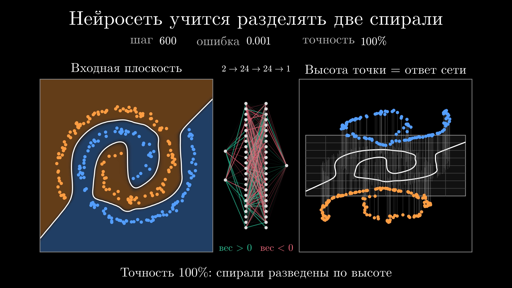
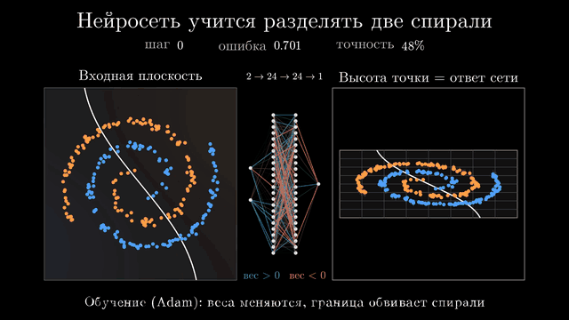
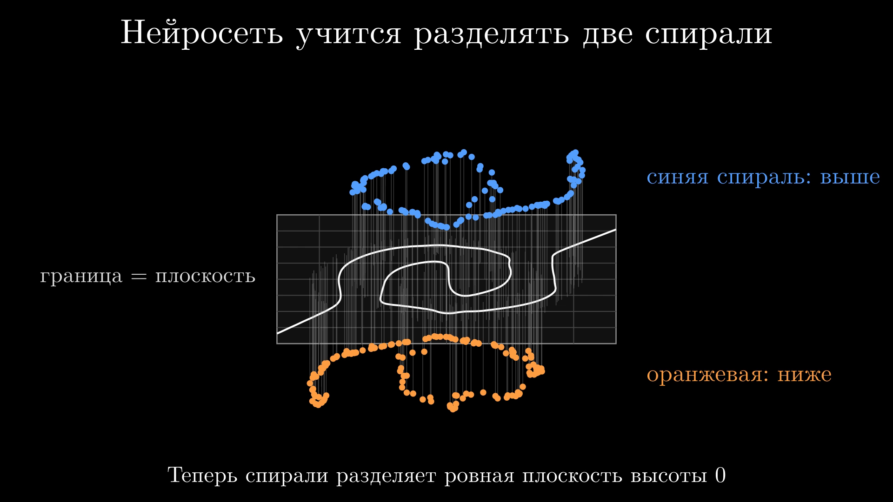

# Нейросеть распутывает две спирали

Минутное видео, в котором маленькая нейросеть учится разделять две переплетённые спирали.
Видно, как гнётся граница решения, как меняются веса и как сеть «поднимает» одну
спираль над другой. Сеть, обучение и вся графика написаны с нуля, без ML-фреймворков:
numpy считает, [ManimGX](https://manimgx.academa.ai) рисует.



▶ **Видео:** [`media/neural-spirals.mp4`](media/neural-spirals.mp4), 60 с, 1920×1080, 60 кадров/с



## Что показывает видео

| Время | Что происходит |
|---|---|
| 0–4 с | Заставка |
| 4–9 с | Появляются данные: 260 точек, две спирали по 1,6 витка |
| 9–16 с | Необученная сеть: случайная граница решения; точки «проходят» через сеть на правую панель |
| 16–39 с | Обучение в реальном времени: заливка областей, граница, веса и счётчики шага, ошибки и точности |
| 39–52 с | Финал крупным планом: плоскость наклоняется, синяя спираль поднимается над оранжевой |
| 52–60 с | Итоги с цифрами именно этого запуска |

Три панели во время обучения:

- **Входная плоскость.** Цвет фона показывает вероятность класса (тёмное — сеть не уверена), белая линия — граница решения *p* = 0,5.
- **Сеть 2 → 24 → 24 → 1.** Каждое ребро — один вес: зелёный положительный, красный отрицательный, яркость — размер веса относительно остальных весов слоя в этот момент.
- **Высота точки = ответ сети.** Та же плоскость под углом, каждая точка поднята на tanh(логит / 5). Обучение буквально разводит спирали по высоте, и граница превращается в плоскость высоты 0.



## Как это устроено

**Данные** ([`spiral_net.py`](spiral_net.py)). Две спирали, одна повёрнута относительно другой на 180°. Радиус точек ∝ √uniform, поэтому точки распределены по рукаву равномерно, плюс небольшой гауссов шум. Генератор фиксирован (seed), видео воспроизводимо.

**Сеть и обучение.** Многослойный перцептрон 2 → 24 → 24 → 1 с tanh, инициализация LeCun-normal. Функция потерь — бинарная перекрёстная энтропия, записанная через `logaddexp`, чтобы не переполняться при больших логитах. Обратное распространение написано вручную, оптимизатор — Adam с коррекцией смещения, полный батч, 600 шагов. Снимки весов сохраняются на геометрически распределённых шагах (180 штук): ранние быстрые изменения получают столько же экранного времени, сколько поздние медленные.

**Результат запуска.** 100% точности на обучающей выборке к 190-му шагу, ошибка 0,0014 на 600-м.

**Визуализация** ([`spirals_scene.py`](spirals_scene.py)):
- Обучение целиком считается до первого кадра. Анимация управляется одним `ValueTracker` с дробным номером снимка, и все величины (вероятности на сетке 110×110, высоты точек, веса, ошибка) линейно интерполируются между соседними снимками. Поэтому движение плавное при любой частоте кадров.
- Граница решения строится собственной векторизованной реализацией **marching squares** (`contour_segments`), заново на каждом кадре.
- Заливка областей — картинка из массива пикселей, тоже пересчитывается на каждом кадре.
- «Подъём» — косая проекция внутри обычной 2D-сцены: *x* остаётся, *y* сжимается, высота добавляется по вертикали.
- 648 рёбер схемы сети разбиты по знаку и 4 уровням величины на 8 составных путей, чтобы перерисовка оставалась дешёвой.

**Тесты** ([`tests/`](tests/test_spiral_net.py)): проверка градиентов конечными разностями, сходимость до 100%, точность контура на окружности, пустой контур без пересечений.

## Запуск

Нужен Python 3.13+ и видеокарта (ManimGX рендерит на GPU через Direct3D 12 / Metal / Vulkan; ffmpeg и LaTeX не нужны).

```bash
python -m venv .venv
.venv/Scripts/activate            # Windows; macOS/Linux: source .venv/bin/activate
pip install -e ".[dev]"

pytest                                             # 5 тестов
python spiral_net.py                               # обучение в консоли
manimgx inspect spirals_scene.py SpiralNet         # раскадровка и проверка вёрстки, без видео
manimgx render spirals_scene.py SpiralNet -o media/neural-spirals.mp4 --crf 18 --preset slow
pip install av pillow && python make_previews.py   # постеры и GIF из готового видео
```

## Структура

```
spiral_net.py        данные, сеть, обучение (Adam), marching squares
spirals_scene.py     сцена ManimGX: 6 актов, от заставки до итогов
make_previews.py     постеры и GIF-превью из готового видео (PyAV + Pillow)
tests/               pytest
media/               видео, постеры, превью
```

## Стек

Python · NumPy · ManimGX (рендер на GPU, Manim-совместимый API) · pytest · PyAV / Pillow

---

## In English

**Neural network untangling two spirals** is a one-minute animation of a small MLP (2 → 24 → 24 → 1, tanh) learning to classify two interleaved spirals, trained live while the scene plays. The left panel shows the decision regions and the boundary, re-traced each frame with a vectorized marching-squares implementation. The middle panel shows every weight of the network, colored by sign. The right panel tilts the input plane and lifts each point to the network's output, so training visibly lifts one spiral over the other until a flat plane separates them.

There are no ML frameworks: the forward pass, backpropagation (checked against finite differences in the tests) and Adam are written in NumPy. 180 weight snapshots, interpolated per frame, drive a 60-second 1080p60 video rendered with ManimGX. This run reaches 100% training accuracy by step 190.
